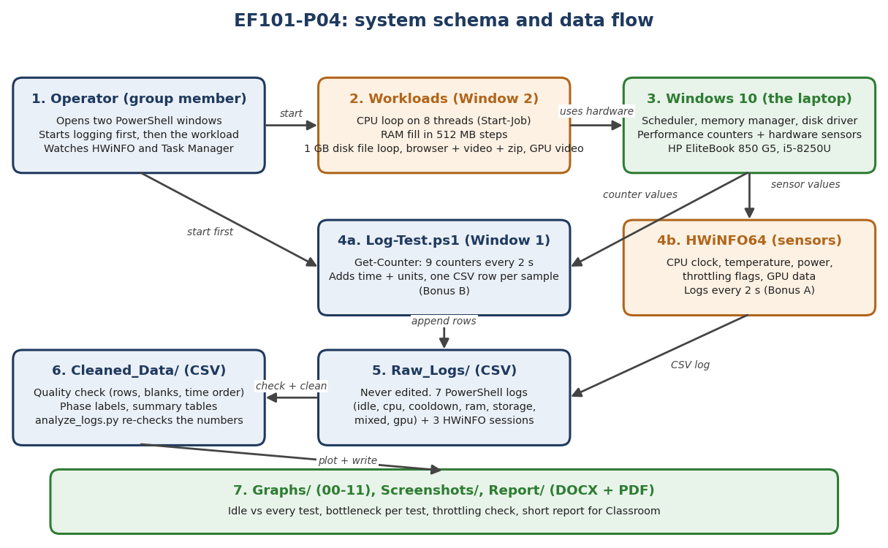
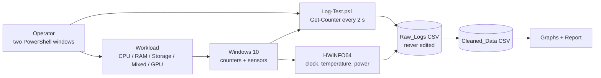

# EF101-P04: How a Laptop Behaves Under Load

**Course:** EF-101 Fall 2026, System Understanding Project  **Submission:** Week 13, Monday 9 November 2026  **Group size:** 3

We measured one laptop (HP EliteBook 850 G5, Intel Core i5-8250U, 8 GB RAM, 256 GB SSD, Windows 10 Pro) while it did different kinds of work.
Every test was logged **every 2 seconds** to a **CSV file**. We then compared each test with an idle baseline and found
**which part limits the laptop in each case** (CPU, RAM, SSD or GPU).

| Team member | Roll no. | Main work (all three ran every test together) |
|---|---|---|
| **Nabia Shamsi** | EE-001 | Data cleaning and quality check, summary tables, graphs, bottleneck analysis, report |
| **Areeza Rehan** | EE-010 | Specifications, HWiNFO logging, `Log-Test.ps1` (Bonus B), thermal-throttling analysis (Bonus A), GPU results |
| **Abdul Muqeet** | EE-038 | Raw-data checks, `Practice_Runs`, idle and mixed workload set-up, live demo |

Full contribution table: `Report/Contribution_and_Tools.md` and report section 11.

---

## 1. Visual schema of the project





## 2. Main results (all numbers come from `Raw_Logs/`)

| Test | CPU avg | Lowest free RAM | Disk write avg | Disk busy avg | Limit (bottleneck) |
|---|---|---|---|---|---|
| Idle (baseline) | 6.1 % | 3.06 GB | 0.3 MB/s | 1.1 % | none |
| CPU load (about 9 min) | 97.6 % | 3.25 GB | 0.4 MB/s | 13.6 % | **Processor** (clock steady, no throttling) |
| RAM load | 11.2 % | 1.10 GB | 0.7 MB/s | 1.2 % | **Memory** (pagefile on the SSD used) |
| Storage load | 18.4 % | 1.83 GB | 256.7 MB/s | 46.3 % | **Disk** |
| Mixed (browser + video + zip) | 17.5 % | 1.53 GB | 10.4 MB/s | 3.9 % | **Memory, then disk** (slow with a low CPU) |
| GPU (full-screen video, integrated GPU) | 39.3 % | 2.47 GB | 2.1 MB/s | 2.7 % | none (GPU 20.5 % avg, 55 °C max) |

**Bonus A (thermal throttling):** two CPU runs on two days. Clock stayed near 2 GHz, temperature levelled off at 66 to 67 °C,
power was about 8.5 W (limit 18 W), HWiNFO showed no throttling flags. **No throttling observed** (only for these runs on this laptop).

**Main lesson:** when a computer feels slow, check memory and disk before blaming the CPU. In the mixed test the CPU was only 17 % busy, yet the computer waited for memory and the disk.

## 3. How this repository meets the project brief

| Requirement (project page) | Where to find it |
|---|---|
| Full test-machine specifications | `Report/specs_utf8.txt`, `Screenshots/01_specs.png`, report section 3.1 |
| Tools and what each measures | report section 3 (PowerShell Get-Counter, HWiNFO64, Task Manager) |
| Idle baseline | `Raw_Logs/idle_*.csv` |
| Separate CPU, RAM, storage and GPU workloads | `Raw_Logs/cpu_*`, `ram_*`, `storage_*`, `gpu_*` |
| Realistic mixed workload | `Raw_Logs/mixed_*.csv`, Graph 07 |
| Automatic logging every 1 to 5 s, CSV export | `Scripts/Log-Test.ps1` (2 s, CSV) |
| CPU clock, temperature, GPU use/temperature/memory, disk, pagefile | `Raw_Logs/hwinfo_*.csv`, `Cleaned_Data/`, Graphs 02, 03, 04, 05, 06, 09, 10 |
| Idle vs each stress test (graphs) | `Graphs/08_comparison_idle_vs_all_tests.png` |
| Bottleneck, utilization vs performance, RAM pressure, throttling, slow-at-low-CPU | report section 6 |
| Submission evidence (raw logs, cleaned data, plots, screenshots, durations, limitations) | `Raw_Logs/`, `Cleaned_Data/`, `Graphs/`, `Screenshots/`, report tables 2 and section 9 |
| Bonus: thermal throttling and logging script | report sections 6.4 and 7 |
| Contribution statement and tool/AI disclosure | `Report/Contribution_and_Tools.md`, report sections 11 and 12 |
| Safety and ethics | report section 10 (no overclock, own laptop, stop rule 95 °C) |
| Short report for Google Classroom | `Report/Short_Report_EF101-P04.pdf` |

## 4. Repository structure

```
EF101-P04/
├── README.md                  this file
├── Raw_Logs/                  original logger files (never edited): 7 PowerShell logs + 3 HWiNFO sessions
├── Cleaned_Data/              checked copies, summary tables, quality report
├── Graphs/                    Graph 00 (schema) and Graphs 01 to 11
├── Screenshots/               specs, HWiNFO, Task Manager, Excel check
├── Practice_Runs/             earlier and invalid runs, kept for honesty (not used in results)
├── Scripts/
│   ├── Log-Test.ps1           the logging script (Bonus B)
│   └── analysis/analyze_logs.py   re-checks the numbers from the raw logs
└── Report/                    full report (DOCX + PDF), short report, concept guide, demo guide, requirements check
```

## 5. Main code segments

**`Scripts/Log-Test.ps1`** (PowerShell, the measuring tool)

| Segment | What it does |
|---|---|
| `$c = '\Processor(_Total)\% Processor Time', ...` | the list of 9 Windows counters (CPU, free RAM, committed RAM, pages/s, pagefile, disk read, disk write, disk busy, disk queue) |
| `Get-Counter -Counter $c -SampleInterval 2 -MaxSamples ($Minutes*30)` | reads all 9 counters every 2 seconds for the chosen minutes |
| `[pscustomobject]@{ ... }` | builds one row: test name, timestamp, elapsed seconds, 9 values with units |
| `Export-Csv -Append` | writes each row to the CSV immediately, so nothing is lost if the test is stopped |
| `try { ... } catch { Write-Host "ERROR: $_" }` | prints an error message instead of crashing on bad input |

**`Scripts/analysis/analyze_logs.py`** (Python, the checker)

| Segment | What it does |
|---|---|
| `quality()` | counts rows and blank cells, checks that time only goes forward, finds the smallest and largest gap |
| `TESTS` table | says which file belongs to which test and which rows are "the load" |
| summary loop | averages CPU, lowest free RAM, paging, disk write and disk busy per test, saves `Cleaned_Data/summary_recomputed.csv` |

## 6. How to run (the running version)

Requirements: Windows 10 or 11, PowerShell 5.1 or later. HWiNFO64 is optional (for clock, temperature, power).

```powershell
# 1. Put this folder at  Documents\EF101-P04   (the script saves into Documents\EF101-P04\Raw_Logs)
# 2. Open PowerShell and run:
Set-ExecutionPolicy -Scope Process -ExecutionPolicy Bypass -Force
. "$([Environment]::GetFolderPath('MyDocuments'))\EF101-P04\Scripts\Log-Test.ps1"
Log-Test -Test demo -Minutes 1
```

A file `demo_<date>_<time>.csv` appears in `Raw_Logs/`, one row every 2 seconds (30 rows for 1 minute).
To run a real test, start `Log-Test -Test cpu -Minutes 11` in Window 1 and start the workload in Window 2.

To re-check the numbers (any computer with Python):

```bash
pip install -r requirements.txt
python Scripts/analysis/analyze_logs.py
```

## 7. System understanding (quick answers)

| Question | Answer |
|---|---|
| What happens from start to output? | The operator starts `Log-Test` in Window 1, then the workload in Window 2. Every 2 s `Get-Counter` reads 9 Windows counters, one CSV row is appended, and later the rows are checked and drawn as graphs. |
| What runs where? | Everything runs on the test laptop. Only the video in the mixed and GPU tests is streamed from the internet. |
| Client, server, database, API? | None. Data is stored in plain CSV files; sensors are read by Windows counters and HWiNFO. |
| What data is stored, where, why? | 9 counters per row in `Raw_Logs/*.csv` (text, opens in Excel and pandas, easy to check). Cleaned copies and summaries are in `Cleaned_Data/`. |
| What if the internet is disconnected? | Measurement continues. Only the video loading in the mixed and GPU tests would fail. |
| What if the data is deleted? | A deleted raw log cannot be recovered; that test must be run again. The script recreates the `Raw_Logs` folder but not old files. |
| Key terms | CPU utilization, RAM, pagefile, disk throughput, bottleneck, throttling: see `Report/Concepts_and_Viva_Guide.md`. |

## 8. Limitations (stated honestly)

- RAM, storage, mixed and GPU tests were each run **once**. Only the CPU test was repeated (and the first CPU attempt was invalid, see `Practice_Runs/`).
- The idle baseline had only about 20 seconds of rest before logging.
- The GPU test is a light video test on an **integrated** GPU, not a heavy 3D stress test.
- Storage read speed is low because Windows served the file from its memory cache; the write speed is the reliable value.
- Task completion time was not measured, so "fast" is judged from speed and disk numbers.
- One laptop only. Results do not apply to other computers.
- The script does not record temperature or clock (HWiNFO does). Logging stops if the PowerShell window is closed.

## 9. Tools and AI disclosure

Tools: Windows Task Manager, PowerShell (Get-Counter, Start-Job, Compress-Archive, Export-Csv), HWiNFO64, Excel, Python (pandas, matplotlib).
An AI assistant (Claude, by Anthropic) helped write the scripts and drafts of the report. The group ran everything on the laptop and checked the numbers against the raw files.
